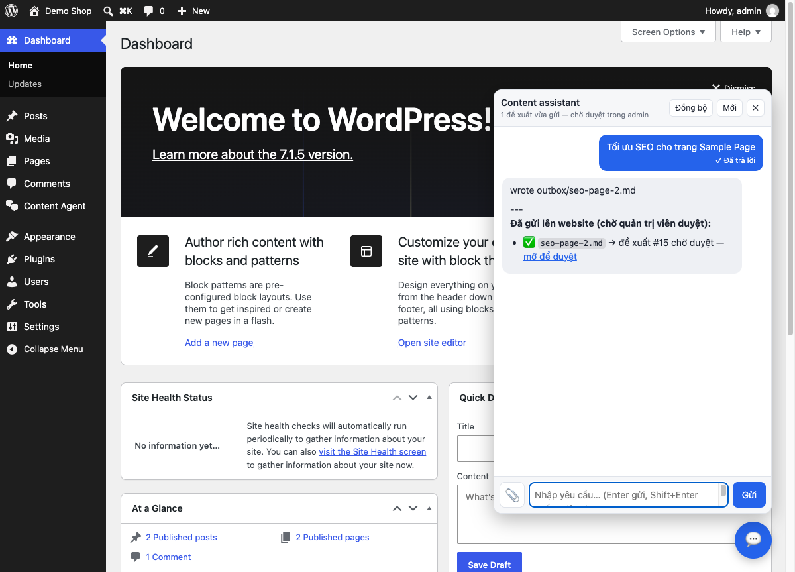
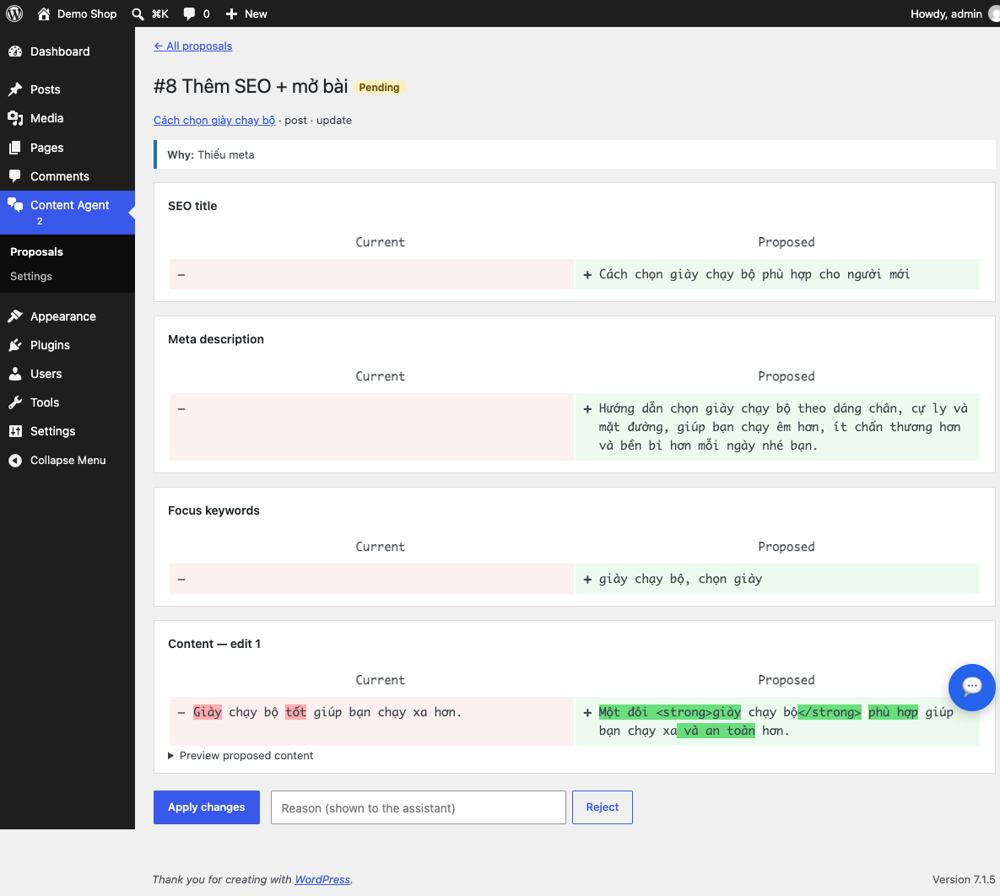
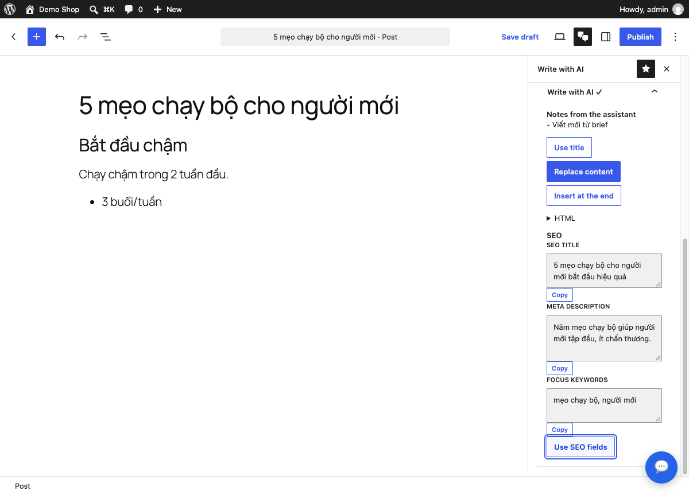

# cms-content-agent: an AI content & SEO agent for WordPress

**Give your WordPress editors an AI assistant that knows every post, page and product on the site.** It audits SEO,
plans content, writes and optimises pages, and **puts every change in a review queue instead of publishing it.**

The project has two parts:

| | What it is | Runs on |
|---|---|---|
| **Backend** (`server/`, `bridge/`) | Node.js service that drives an AI coding agent: **Claude Code**, **OpenAI Codex** or **agy**, with automatic fallback | a VPS or any Docker host |
| **WordPress plugin** (`wordpress/content-agent/`) | Chat in wp-admin, review queue, "Write with AI" sidebar in the block editor, SEO audit, REST API for the backend | your WordPress site (6.2+, PHP 7.4+) |

It supports posts, pages, categories, **WooCommerce** products and product categories, and **Yoast SEO** or **Rank Math**.
Without an SEO plugin, it uses its own SEO fields.

[Tiếng Việt](README.vi.md) · [Deploy](docs/DEPLOY.md) · [Plugin ↔ backend API](docs/SITE_API.md) · [Roadmap](docs/PLAN.md) · [Contributing](CONTRIBUTING.md)

> The agent's prompts and skills are written in Vietnamese (the project's first users), and the plugin ships English + Vietnamese UI.
> Prompts are plain Markdown in `agent/` and `skills/`. Translations are welcome.

---

## What editors get

| Chat in wp-admin | Review queue | Write with AI (block editor) |
|---|---|---|
|  |  |  |

- **A chat button in wp-admin.** Editors can ask, for example, *"Which posts have no meta description?"*, *"Plan 10 articles around
  'trail running shoes'"* or *"Rewrite the intro of the About page"*. Answers stream in, and images can be attached; they go to the media library.
- **A review queue (Content Agent → Proposals).** Each suggested change shows a side-by-side diff of title, content,
  excerpt and SEO fields. You can apply it, reject it with a reason the assistant will see, or revert it later.
  New posts and pages are always created as **drafts**.
- **Write with AI in the block editor.** A sidebar drafts or optimises the post you are editing and fills in the title, content
  (as real Gutenberg blocks) and SEO title, description and keywords.
- **An SEO audit** of all published content. It checks meta title and description length, focus keyword usage, thin content,
  headings and image alt text, and uses the Yoast or Rank Math score when available.
- **Safe WooCommerce edits.** The assistant improves product descriptions, but prices, SKU, stock and attributes are
  read-only. A proposal that changes or drops a figure is refused by the plugin.

## How it works

```
 WordPress (plugin)                               cms-content-agent backend              Agent CLI
┌───────────────────────────────┐   SSE chat    ┌───────────────────────────────┐ spawn ┌─────────────┐
│ wp-admin chat widget          │ ─────────────►│ /api/chat  /api/compose       │ ─────►│ claude -p   │
│ "Write with AI" sidebar       │  short-lived  │ conversations + usage log     │       │ codex exec  │
│ token via admin-ajax          │  HMAC token   │ data/sites/<id>/ = workspace  │◄───── │ agy -p      │
│                               │               │   synced content (read-only)  │ JSONL └─────────────┘
│ REST /wp-json/content-agent/v1│◄── sync ──────│   plans/ drafts/ outbox/      │
│   posts pages products seo …  │               │                               │
│ Proposals queue (review/apply)│◄── POST ──────│ outbox → /proposals           │
└───────────────────────────────┘               └───────────────────────────────┘
```

The agent works **only on files**: synced content plus its own plans, drafts and proposals. It has no shell or
network tools. The backend syncs data and delivers proposals, and **WordPress validates and applies them only when a
person clicks Apply.**

## Setup (about 10 minutes)

**1. Run the backend** on a server you control (needs a public HTTPS URL):

```bash
git clone https://github.com/ptnghia/cms-content-agent.git && cd cms-content-agent
cp .env.example .env
echo '{}' > config/sites.json
docker compose up -d --build            # Claude Code preinstalled; or: npm start (Node 22.13+)
docker compose run --rm agent claude    # log in once (or set ANTHROPIC_API_KEY in .env)
```

Put it behind HTTPS (nginx/Caddy, SSE buffering off; see [docs/DEPLOY.md](docs/DEPLOY.md)).

**2. Install the plugin.** Download `content-agent.zip` from the
[latest release](https://github.com/ptnghia/cms-content-agent/releases) (or run `npm run build:wp`), then go to
*Plugins → Add New → Upload* and activate it.

**3. Connect them.** In *Content Agent → Settings*, enter the backend URL and save. Copy the **Backend configuration**
block it shows into `config/sites.json` on the backend and restart (`docker compose restart`). The settings page shows
*Reachable* when the backend answers.

**4. Use it.** Click the chat button at the bottom right of wp-admin, then **Đồng bộ** (sync) for the first sync.

### Try it locally without a server

```bash
npm run mock-site      # fake website API with 235 posts on :4000
npm run dev            # backend + demo admin page on http://127.0.0.1:3000
```

To test the plugin, run WordPress Playground with the plugin mounted:
`npx @wp-playground/cli server --mount=./wordpress/content-agent:/wordpress/wp-content/plugins/content-agent --login`.

## Agent backends

| `AGENT_BACKEND` | CLI | Streaming | Resume | Usage / cost | Notes |
|---|---|---|---|---|---|
| `claude` (default) | [Claude Code](https://docs.anthropic.com/en/docs/claude-code) | tokens | `--resume` | tokens + USD | `Bash`, `WebFetch`, `WebSearch` disabled by default |
| `codex` | [OpenAI Codex CLI](https://github.com/openai/codex) | final message | `exec resume` | tokens | sandbox `workspace-write`, no network |
| `agy` | agy | tokens | `--conversation` | as reported | headless mode refuses commands |

`AGENT_FALLBACK=codex` retries a failed turn on another CLI. To add a CLI, create `bridge/adapters/<name>.mjs`
(see `bridge/index.mjs` for the contract).

## Backend configuration

`.env` (all options in [.env.example](.env.example)):

| Variable | Default | |
|---|---|---|
| `AGENT_BACKEND` / `AGENT_FALLBACK` | `claude` / – | primary and backup CLI |
| `MAX_CONCURRENT` | `2` | agent processes at once |
| `CHAT_PER_HOUR` / `COMPOSE_PER_HOUR` | `60` / `12` | per-user rate limits (`0` = off) |
| `STORE_DRIVER` | `file` | `sqlite` for many conversations (`npm run migrate:sqlite`) |
| `SYNC_INTERVAL_MIN` | `0` | periodic sync of every site |
| `SYNC_ALERT_WEBHOOK` | – | Slack/Discord-compatible alert when sync keeps failing |

`config/sites.json` holds one entry per WordPress site, exactly as the plugin's settings page prints it. One backend can
serve many sites.

## Backend HTTP API

The widget and the editor sidebar use these endpoints. All of them except health and widget need
`Authorization: Bearer <token>` minted by the plugin.

| Method | Path | |
|---|---|---|
| POST | `/api/chat` | `{message, conversationId?}` → SSE `init`, `step`, `delta`, `proposals`, `result`, `error` |
| POST | `/api/compose` | block-editor sidebar → SSE `progress`, `result {fields, notes}` |
| GET / DELETE | `/api/conversations[/:id]` | the user's conversations |
| POST | `/api/sync` · GET `/api/status` | sync now · last sync and sync health |
| GET | `/api/usage?days=30` | tokens, cost and requests for the user and the site |
| GET | `/api/health`, `/widget.js` | public |

The plugin's REST API (`/wp-json/content-agent/v1/…`, called by the backend with the site API key) is documented in
[docs/SITE_API.md](docs/SITE_API.md).

## Security model

- **Nothing is published by the AI.** Proposals need a logged-in user with permission to edit that page. New content is created as drafts.
- **Each site has two secrets**, both generated by the plugin and stored only on the two servers: the API key the backend
  uses to call WordPress, and the token secret used to sign 15-minute chat tokens. Chat tokens are bound to one site and one user.
- Conversations are private to the WordPress user who started them, and CORS is limited to the site's origin.
- **The agent can only read and write workspace files.** Shell and network tools are disabled, and synced data is read-only on disk.
- Report vulnerabilities privately: see [SECURITY.md](SECURITY.md).

## Development

```bash
npm test            # backend tests (fake CLIs + fake WordPress API), file and sqlite stores, PHP <-> Node token check
npm run lint:php    # php -l on the plugin
npm run build:wp    # dist/content-agent.zip
npm run smoke       # live 2-turn check against your real agent CLI
```

## License

[MIT](LICENSE)
